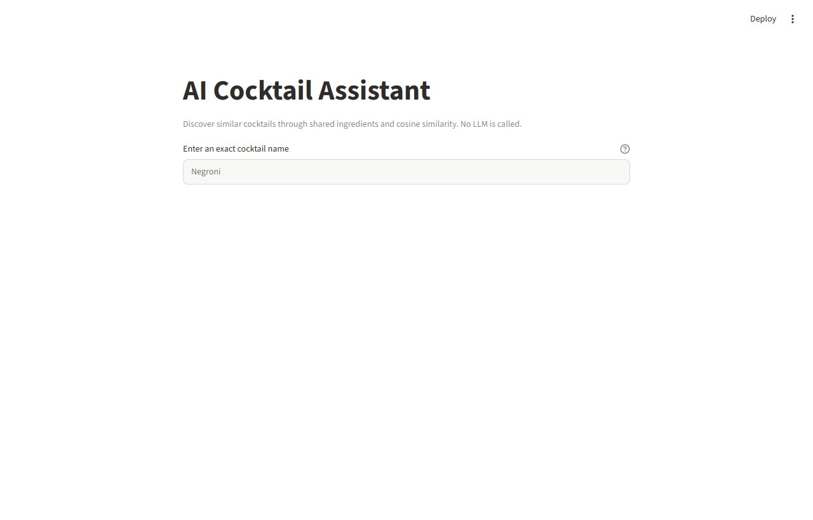

# AI Cocktail Assistant

A small Streamlit demo that recommends cocktails with similar ingredient sets. The current engine uses binary ingredient features and cosine similarity; it does not use an LLM or learn from user feedback.



[Open the existing Streamlit app](https://aicocktailassistant.streamlit.app/) or run locally below. The GIF was captured from the running local app; [recording details](docs/record-demo.md) include versions and source hashes. Tied recommendations may appear in a different order across dependency versions.

## Run locally

Use Python 3.10 or newer. For a fresh checkout:

```bash
git clone https://github.com/smgpulse007/AICocktailAssistant.git
cd AICocktailAssistant
```

From the repository root, create an environment and start the app:

```bash
python -m venv .venv
# Activate with: source .venv/bin/activate (macOS/Linux)
# Or: .venv\Scripts\Activate.ps1 (PowerShell)
python -m pip install -r requirements.txt
python -X utf8 -m streamlit run app.py --server.address 127.0.0.1 --browser.gatherUsageStats false
```

Open **http://127.0.0.1:8501** and enter an exact cocktail name from `recipes.json`, such as `Negroni`, then press Enter. The engine accepts cocktail names only and matching is case-sensitive. An unknown name returns a "No data" message. UTF-8 mode makes the checked-in recipe text load consistently on Windows; usage-statistics collection is disabled by the command above.

## How recommendations work

1. `data_preparation.py` loads the checked-in ingredient and recipe JSON files.
2. Each recipe becomes a binary vector: 1 for an ingredient present in the vocabulary, 0 otherwise.
3. `recommendation_engine.py` computes cosine similarity between those vectors.
4. The selected cocktail's similarity scores are sorted and up to five names are returned to the UI.

Ingredient quantities, flavor descriptions, preparation instructions, and personal taste are not used in the similarity calculation. Tied scores do not have a dedicated tie-breaking policy; the current implementation skips the first sorted result rather than explicitly removing the selected name.

## Files

| File | Purpose |
| --- | --- |
| `app.py` | Streamlit input and recommendation list |
| `data_preparation.py` | JSON loading and binary feature preparation |
| `recommendation_engine.py` | Cosine-similarity lookup |
| `ingredients.json`, `recipes.json` | Checked-in demo data |
| `requirements.txt` | Python dependencies |

Running `python data_preparation.py` writes an optional `cocktail_features.csv`. The app builds its features directly from JSON and does not read that CSV.

## Smoke check

```bash
python -X utf8 -c "from recommendation_engine import recommend_cocktails; print(recommend_cocktails('Negroni'))"
```

No recommendation-quality benchmark is included. This is a content-similarity example, not evidence of personalization or nutritional suitability.

## Known limitations and contributions

- JSON files currently use the operating system's default text encoding; UTF-8 data may need UTF-8 mode on some Windows setups.
- Ingredient-only queries and case-insensitive lookup are not implemented in current main.
- A useful follow-up would explicitly exclude the query cocktail, test ties and unknown names, and evaluate recommendations on a documented dataset.
- Please preserve attribution and coordinate with existing pull requests before changing shared code.

## License status

There is no `LICENSE` file in the current repository. This README does not grant an MIT license; the owner needs to establish the intended code and data licensing before reuse or redistribution.

